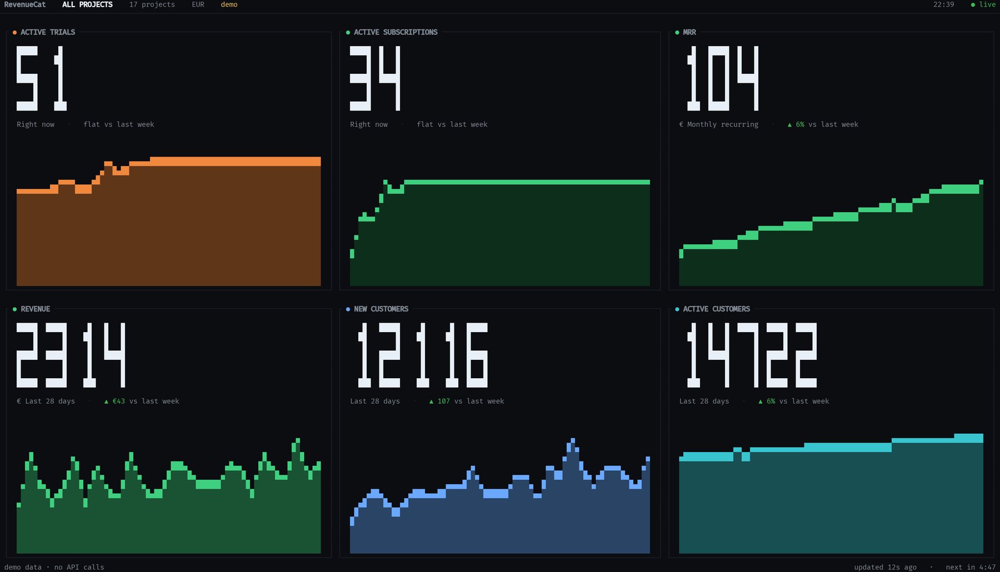

# rc-tui

RevenueCat's Overview page in a terminal: six metric cards with sparklines, polled
every five minutes, with tweened numbers, morphing charts and a short highlight
on every card that changed.

It can watch one project or all of them at once. "All projects" sums the same
metrics the dashboard sums, and `p` opens a filterable project picker. Enter on a
card opens a 7/28/90-day detail view with a per-project breakdown; `!` shows the
health of every project, and `?` lists every key.



*`rc-tui --demo` — 17 mocked projects, no credentials.*

Values are the hero (big block digits), the trend compares the last week with the
one before, and the footer keeps only the refresh status once you stop pressing
keys. Hints appear for ten seconds after a keypress. A failing project keeps its
last known values, the totals are marked `*`, and the header shows `n/17 live`
instead of pretending the missing project is zero.

## Many apps? Count projects, not apps

Keys are per project, and a project can hold several apps (iOS, Android, web
builds of the same product), so a dozen apps may need a dozen keys — or only two
or three. The dashboard's project switcher shows how many projects you actually
have.

Creating the keys is the only manual part: one **+ New secret API key** per
project, with Charts & Metrics: Read. Then bring them in together:

```sh
rc-tui --import
```

Paste one key per line and press Ctrl+D. Every key is checked in one pass and
the screen shows a ✓/✗ per line with the reason, so one bad key does not stop
the rest. If a key lacks Project Configuration: Read, put its project
id on the same line (`proj1a2b3c4d sk_…`); otherwise the id and name are
discovered automatically. Enter saves the ones that work. `i` opens the same
screen from the dashboard.

## Setup

No configuration needed to look around:

```sh
rc-tui --demo
```

For real numbers, run `rc-tui` once:

```sh
rc-tui
```

1. RevenueCat dashboard → your project → **API keys** → **+ New secret API key**.
2. Grant it **Charts & Metrics: Read** — the scopes `charts_metrics:overview:read`
   and `charts_metrics:charts:read`.
3. Optionally add **Project Configuration: Read**
   (`project_configuration:projects:read`) so rc-tui can list and pick your
   project instead of asking for the id.
4. Paste the key. Both required scopes are checked (metrics and charts) before
   anything is saved to `~/.config/rc-tui/config.toml` (mode `600`).
5. Answer `y` to add your next project, or `n` to open the dashboard.

Docs: <https://www.revenuecat.com/docs/projects/authentication>

Things the wizard handles for you:

- A key that cannot list projects falls back to a project id field, no dead end.
- A rejected key, a missing scope or a wrong project id shows the reason, the
  exact permission or id to fix, and RevenueCat's own error link.
- `--setup` reopens the wizard (edits the first project), `--add-project` adds a
  new one, `s` and `a` do the same from the dashboard.
- `--check` validates every saved project without drawing the TUI:

```sh
rc-tui --check
```

```text
Checking MagicWeather (proj1a2b3c4d) with key ••••abcd …
  metrics ✓ 6 metrics
    Active Trials          3
    ...
  charts  ✓
Checking Notes (proj5e6f7g8h) with key ••••wxyz …
  metrics ✓ 6 metrics
  charts  ✓

All 2 project(s) have metrics and charts. Run `rc-tui` to open the dashboard.
```

Credentials resolve in this order: CLI flag, environment variable, config file.
Flags and environment keep working; the file is only a fallback.

## Config file

```toml
# ~/.config/rc-tui/config.toml, mode 600

currency = "EUR"
chart_minutes = 15      # chart cache; overview still refreshes every 5 minutes
motion = "full"         # full | minimal | off
wall = false            # start without header/footer chrome
pins = ["proj5e6f7g8h"] # picker order, most useful first

[[projects]]
id = "proj1a2b3c4d"
api_key = "sk_..."
name = "MagicWeather"

[[projects]]
id = "proj5e6f7g8h"
api_key = "sk_..."
```

Files from earlier versions with a single `project_id` / `api_key` are migrated
on the next save.

## Build

```sh
cargo build --release
cargo install --path .   # ~/.cargo/bin/rc-tui
```

## Flags

| Flag | Env | Default | |
| --- | --- | --- | --- |
| `--project-id` | `RC_PROJECT_ID` | config file | RevenueCat project ID |
| `--api-key` | `RC_API_KEY` | config file | v2 secret API key |
| `--currency` | `RC_CURRENCY` | `EUR` | currency for monetary metrics |
| `--interval` | | `300` | seconds between refreshes |
| `--base-url` | | `https://api.revenuecat.com/v2` | API base URL |
| `--demo` | | | synthetic data, no credentials |
| `--check` | | | validate every project (metrics and charts) |
| `--setup` | | | edit/re-run the setup wizard |
| `--add-project` | | | add a project without touching the saved ones |
| `--import` | | | bulk-add projects, one secret key per line |

Supplying both `--api-key` and `--project-id` watches just that project and
ignores the config file.

Dashboard: `q`/`Esc` quit · `r` refresh (forces charts) · `p` project picker ·
`←`/`→`/`↑`/`↓`/`Tab` move card focus · `Enter` metric detail · `!` project health ·
`?` help · `w` wall mode · `x` export CSV · `a` add · `i` import · `s` setup.

Picker: type to filter, `↑`/`↓` move, `Enter` open, `Esc` close, `Ctrl+F` pin,
`Ctrl+E` edit, `Ctrl+D` remove (press twice).

Detail: `Esc` back, `↑`/`↓` previous/next metric, `t` 7/28/90 days, `j`/`k` the
project table, `Enter` scope the dashboard to that project.

## Data sources

- Cards: `GET /v2/projects/{id}/metrics/overview?currency=...`
- Sparklines: `GET /v2/projects/{id}/charts/{name}?realtime=true&resolution=0`
  with `trials`, `actives`, `mrr`, `revenue`, `customers_new`, `customers_active`
  (last 28 days, annotated per card from its `period`).
- "All projects" sums card values and resamples/sums the sparklines. It mirrors
  the dashboard aggregate but is computed locally. A project whose key fails
  keeps its last known values, marked `*` with `n/17 live`; the health view (`!`)
  names it and `r` retries.
- Charts are cached for 15 minutes (`chart_minutes`); the overview refreshes
  every five minutes. `r` forces every chart. The detail view fetches 90-day
  charts on demand: one request per project for "All projects", one for a scoped
  project.

The key needs the Charts & Metrics scopes `charts_metrics:overview:read` and
`charts_metrics:charts:read`. Charts are production-only; a v1 key will not work
against the v2 API. Charts & Metrics allow 25 requests per minute per project.
An automatic refresh sends one overview request per project and charts only when
the 15-minute cache expires.

## Not available in the public API

- The Recent transactions feed has no endpoint; it can only be reconstructed
  per customer/subscription, so it is not shown.
- There is no sandbox/production toggle for these metrics.
- New and Active Customers can be cached by RevenueCat for one to two hours.

## License

GPL-3.0
