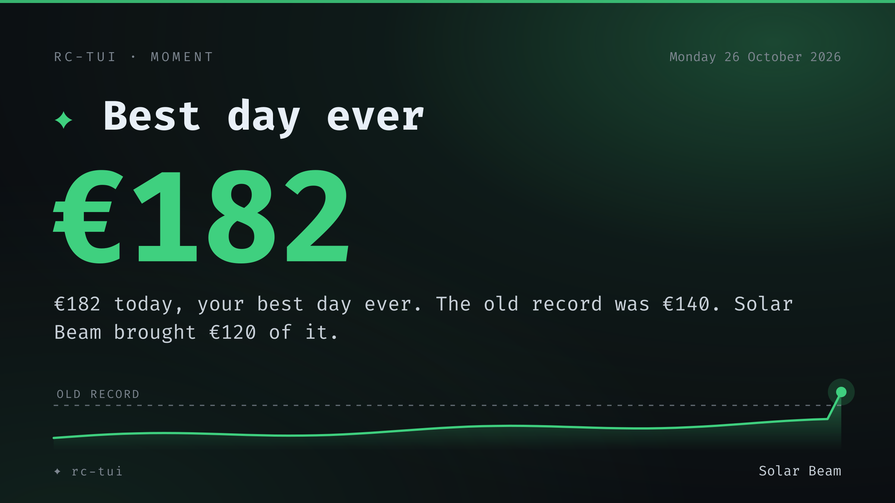

# rc-tui

RevenueCat in a terminal, built around the people your apps reach and the money
that actually arrived: how many people used your apps in the last 28 days, what
they paid across every kind of purchase, how that compares with the 28 days
before, your enough line, and every app at a glance. A live purchase and review
feed, a project picker, 7/28/90-day detail and per-project health sit around it.

[](docs/rc-tui-demo.png)

*`rc-tui --demo` — 17 mocked projects, no credentials. Click for full size.*

[Showcase](docs/showcase.png): home, one app, light theme, wall, metric detail, a smaller terminal and the full feed.

## Philosophy

- **People first.** The first number is the people who used your apps; revenue
  sits beside it, and the headline says both in one sentence.
- **Money that arrived.** Revenue over the last 28 days counts every purchase:
  one-time, lifetime and subscriptions. MRR is one small card, not the goal, so
  nothing nudges a product toward a subscription it does not need.
- **Four weeks, not one.** Every trend compares the last 28 complete days with
  the 28 before. Four whole weeks cancel out weekday swings, and the faint line
  in People and Revenue is the 28 days before.
- **Calm by default.** Growth is lit, a change within 5% is steady, and a dip is
  said plainly in grey, never red. A doubling or more reads as a multiple.
- **Enough.** Set `enough` to the 28-day revenue that covers your life; the line
  fills toward it, then shows what is beyond it.
- **Every app counts.** Your apps are listed by the people they reached, so the
  quiet ones stay in view.

## Install

```sh
cargo install --git https://github.com/guitaripod/rc-tui   # ~/.cargo/bin/rc-tui
rc-tui --demo                 # look around without credentials
rc-tui watch --install        # moments in the background, started now
```

## Setup

Run `rc-tui` once. It asks for a RevenueCat **v2 secret API key** and picks the
project for you.

1. Dashboard → your project → **API keys** → **+ New secret API key**.
2. Grant **Charts & Metrics: Read** (`charts_metrics:overview:read`,
   `charts_metrics:charts:read`). Adding **Project Configuration: Read**
   (`project_configuration:projects:read`) lets rc-tui list your projects.
3. Paste the key; answer `y` to add the next project.

Keys are project-scoped: one key covers every app in its project, so a dozen apps
may need only a few keys. For many projects at once, use `rc-tui --import` and
paste one key per line. Credentials are saved to
`~/.config/rc-tui/config.toml` (mode 600).

```sh
rc-tui --check    # validate every saved project: metrics and charts
```

## Keys

```text
home        q quit · r refresh · p projects · f activity · m moments · Enter detail · ? help
            ! health · w wall · T light/dark · x export CSV · a add · i import · s setup
            ←→↑↓/Tab focus · + - UI scale · [ ] page
picker      type to filter · ↑↓ · Enter open · Esc close
            Ctrl+F pin · Ctrl+E edit · Ctrl+D remove (twice)
detail      Esc back · ↑↓ metric · t 7/28/90 days · j/k project · Enter scope
activity    f/Esc/q close · j/k move · Tab filter · [ ] 24h/7d/28d/all · g/G ends
```

`+`/`-` cycles the UI scale: auto is the home layout, then 3, 2 or 1 cards per
page; `[`/`]` changes page. Scale, page, wall, pins and the last project persist in the config. `x`
writes a CSV to `~/.local/share/rc-tui/exports/`.

## Activity

`f` opens the activity feed; on wide terminals it is always visible in a rail
beside the cards. It reads `~/.local/state/storebot/feed.json`, written by
[storebot](https://github.com/guitaripod/storebot). Every row is a timed event:
live sales, renewals, App Store purchases, every written review App Store
Connect exposes, and stars-only ratings when storebot observes a new one. The
rail header keeps the all-time rating count as a single number; it is not a
static block in the stream. Each item is a card with a full title that wraps
instead of truncating; first-ever sales, big sales, five-star reviews and
reviews that need attention light the whole activity section. On first run it
seeds 14 days of paid App Store sales, all available written reviews and the
current two days of hook-log purchases; seed rows are marked as history and are
never counted as new. Apple does not expose individual stars-only ratings, so
only new totals after storebot starts are definite events, not invented ones.

rc-tui only reads the feed: it makes no extra RevenueCat, App Store or Telegram
requests. Without storebot, the rail shows `NOT CONNECTED` and the metric
dashboard is unaffected.

## Moments



`rc-tui watch` runs in the background and notices when something significant
happens. The first time, it learns your history: every record, every country
that ever bought, every app that has sold. Nothing fires until that is learned,
so installing it never floods you with old news. After that, each significant
thing becomes a moment.

Moments are rare on purpose. A routine sale stays a quiet line in the feed, and
the things worth stopping for get a card you can keep and a note about why it
happened.

What counts as a moment:

- **Best day ever**: revenue across all your apps, today or yesterday, beats
  every day before it.
- **Best 28 days ever**: at most once every 28 days.
- **Your `enough` line**: revenue reaches it. It re-arms once revenue falls
  below 90% of the line.
- **People milestones**: across all apps at 100, 250, 500, 1,000, 2,500 and
  5,000, then 10,000 and up; per app at 1,000, 10,000 and 100,000.
- **First sale** of an app.
- **First purchase from a new country**.
- **First yearly subscriber** of an app.
- **Five-star reviews** with words in them.

Two alerts are never kept as moments: a 1 or 2 star review, and storebot's
activity feed going quiet for 15 minutes. When the feed is back, you get a note
saying so.

A moment lands in up to five places:

- **A desktop notification** on Linux servers such as Plasma, GNOME, mako and
  dunst, or in macOS Notification Center. On Plasma the card is attached, the
  notification has an **Open rc-tui** action that opens the dashboard on that
  moment, and an inline **Add a note** reply ("What made this happen?") that is
  saved with the moment.
- **A card**: a 2400×1350 PNG in your pictures folder (needs `rsvg-convert`).
- **A chime** for major moments: a short tone, synthesized.
- **Lights**: a slow pulse of your RGB hardware in the moment's color, through
  the OpenRGB CLI. Your previous state is restored afterwards.
- **A command** of your choice, such as a Telegram bot, which receives the text
  and the card path.

Major moments are best day, best 28 days, your `enough` line, people milestones
and first sales. Only those get the chime and the lights. Nothing makes a sound
or lights up during quiet hours (23-08 by default) or while do-not-disturb is
on.

In the dashboard, the newest moment of the week appears under the headline.
Press `m` for the list of moments with notes, and Enter on a moment to open its
card. A new moment shows a celebration banner while rc-tui is open.

```sh
rc-tui watch --install             # systemd user service (Linux) or launchd agent (macOS), desktop entry and icon; starts it
rc-tui watch --uninstall           # remove it
journalctl --user -u rc-tui-watch -f   # logs on Linux
rc-tui watch                       # run in the foreground
rc-tui watch --dry-run             # learn and print the records once; saves and notifies nothing
rc-tui moments                     # list moments in the terminal
rc-tui moments --test              # send a sample moment through every channel
rc-tui moments --yearbook [YEAR]   # the year's moments as one tall poster
rc-tui moments --card ID           # render a card again, for example after adding a note
```

The log is `~/.local/state/rc-tui/moments.jsonl`, one JSON object per line, with
notes appended to it. The watcher's memory is
`~/.local/state/rc-tui/moments-state.json`. Cards and yearbooks go to
`~/Pictures/rc-tui` by default, taken from `user-dirs.dirs`.

Everything is optional. These go in `config.toml`:

```toml
[moments]
cards = "~/Pictures/rc-tui"        # where cards and yearbooks go
quiet = "23-08"                    # no sound or lights; "off" to disable
notify = true
sound = true
lights = true                      # OpenRGB, when installed
lights_profile = "Lights off"      # OpenRGB profile to restore; otherwise the current state is saved first
minutes = 15                       # how often RevenueCat is read
command = ["~/Dev/storebot/storebot.py", "--send", "{text}", "--photo", "{card}"]
terminal = ["ghostty", "-e"]       # what "Open rc-tui" launches; detected when unset
```

The `command` placeholders are `{text}` (the glyph, title, sentence and note),
`{title}`, `{line}`, `{value}`, `{card}`, `{kind}` and `{id}`. The whole moment is
also in the `RC_TUI_MOMENT` environment variable as JSON. The command runs only
for moments nobody has announced yet. storebot already pings sales and reviews,
so those skip it.

## Config

```toml
currency = "EUR"
chart_minutes = 15      # chart cache; the overview still refreshes every 5 min
enough = 3000           # optional: the 28-day revenue that is enough for you

[[projects]]
id = "proj1a2b3c4d"
api_key = "sk_..."
name = "MagicWeather"
```

Optional keys: `ui_scale = 0..3` (0 auto, 1 = 3/page, 2 = 2/page, 3 = 1/page),
`motion = "full" | "minimal" | "off"`, `theme = "auto" | "light" | "dark"` (auto
reads the terminal background and falls back to dark), `wall = true`,
`pins = ["proj..."]`,
`feed_path = "/path/to/feed.json"` (defaults to the storebot state path).
`feed_seen_at` is the read cursor and is maintained automatically.

## Data

- Cards: `GET /v2/projects/{id}/metrics/overview`; sparklines:
  `GET /v2/projects/{id}/charts/{name}` (57 days: the 28 shown, the 28 they are
  compared with, and today). Purchases are the revenue chart's daily
  transactions, so they cost no extra request; they include renewals and are
  not refunded away.
- "All projects" sums projects locally. A failed project keeps its last known
  values; totals are marked `*`, the header shows `n/17 live`, and `!` names the
  failure.
- Charts cache for 15 minutes; `r` forces a refresh. Charts & Metrics are
  production-only; v1 keys do not work with v2.
- The activity feed is produced by storebot from RevenueCat webhooks, Apple
  server notifications and App Store review polling; rc-tui only reads it.
  Recent transactions and the sandbox toggle still have no public RevenueCat
  API. New and Active Customers can lag by one to two hours.

## License

GPL-3.0
