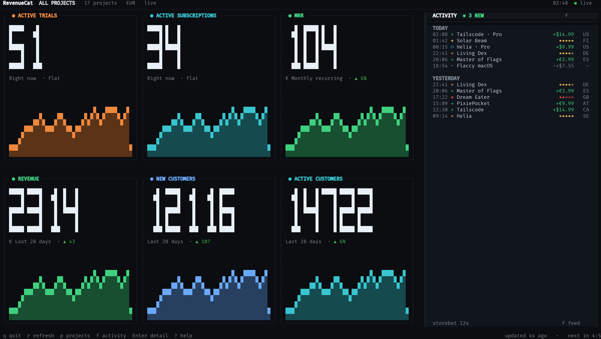
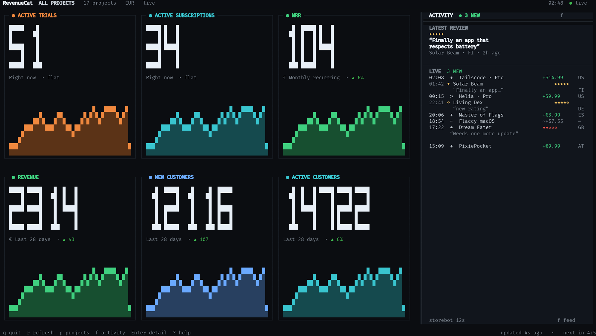

# Activity feed — three layout iterations

All iterations are at **200×54**, the roomy terminal that exposed the wasted
horizontal space in the original full-width shelf. The final spec is in
[`activity-feed-spec.md`](activity-feed-spec.md).

## Iteration 1 — Right rail

**Move the feed to a full-height right rail; cards stay 3×2 on the left.**

What worked:

- The 57-column rail uses horizontal space that the shelf left empty.
- Cards narrow from 66 to 45 columns but gain height; all five-digit values and
  chart shapes remain legible.
- A permanent feed is visible without stealing vertical space from the cards.

What failed:

- One-line reviews collapse to an app name and stars. The review voice — the
  reason to show reviews at all — disappears.
- The lower half of the rail is empty at normal event volume.
- The rail has no temporal context; it reads like a log tail.

## Iteration 2 — Review-first rail

**Give reviews two lines and a spotlight; keep the rail.**

What worked:

- A latest-review block at the top gives the rail a point of view.
- Two-line review rows restore a readable quote, while purchases and ratings
  stay one line.
- The rail feels editorial rather than machine-generated.

What failed:

- The spotlight and stream can duplicate the same event if the spotlight is not
  excluded from the stream.
- The rail still has long empty runs; it shows a list, not a picture of the day.
- Negative reviews are buried below newer positive ones; the most actionable
  feedback is not surfaced.

## Iteration 3 — Pulse rail (chosen)

**Add a 24-hour pulse strip and an attention pin; keep the two-line stream.**

What worked:

- The 24-hour histogram uses the rail's width to show rhythm: purchases and
  reviews stacked by hour. It makes the rail feel alive even when the stream is
  short.
- The attention pin surfaces the newest unseen 1–2★ review, with its quote and
  territory, without a modal or a notification.
- Two-line review rows remain; purchases stay compact.
- The rail fills its height with meaning: pulse → attention → live stream →
  heartbeat. Cards remain 3×2 at 45×24 with larger charts.
- At narrower widths the layout falls back to the shelf, then the ticker, so
  the wide-screen idea never damages the standard terminal.

Why this wins:

| Criterion | Iter 1 | Iter 2 | Iter 3 |
|---|---|---|---|
| Uses horizontal space | yes | yes | yes |
| Review text readable | no | yes | yes |
| Temporal context | no | no | yes |
| Surfaces risk | no | partly | yes |
| Cards stay legible | yes | yes | yes |
| Works when short/narrow | fallback | fallback | fallback |

## Chosen responsive rules

| Width / height | Activity |
|---|---|
| ≥172 cols and ≥46 body rows | Pulse rail, 48–64 cols |
| 96–171 cols and ≥40 body rows | Full-width shelf |
| 96–171 cols and 34–39 body rows | Compact shelf |
| <96 cols or <34 body rows | One-line ticker |

The shelf is not discarded; it is the standard-terminal expression of the same
information hierarchy. The rail is the wide-screen expression.
