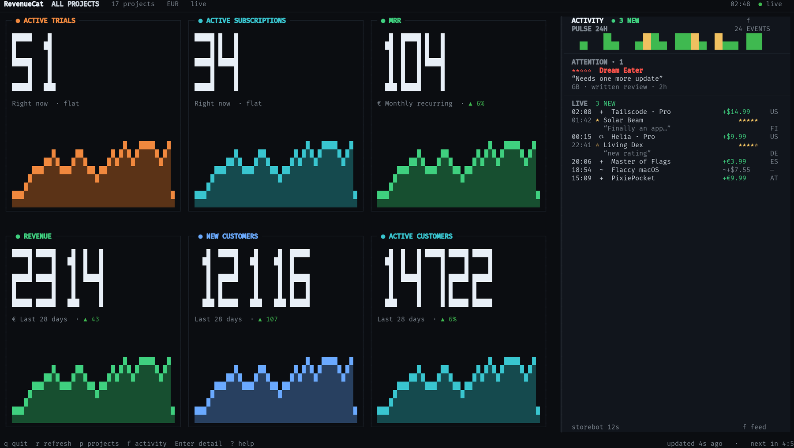
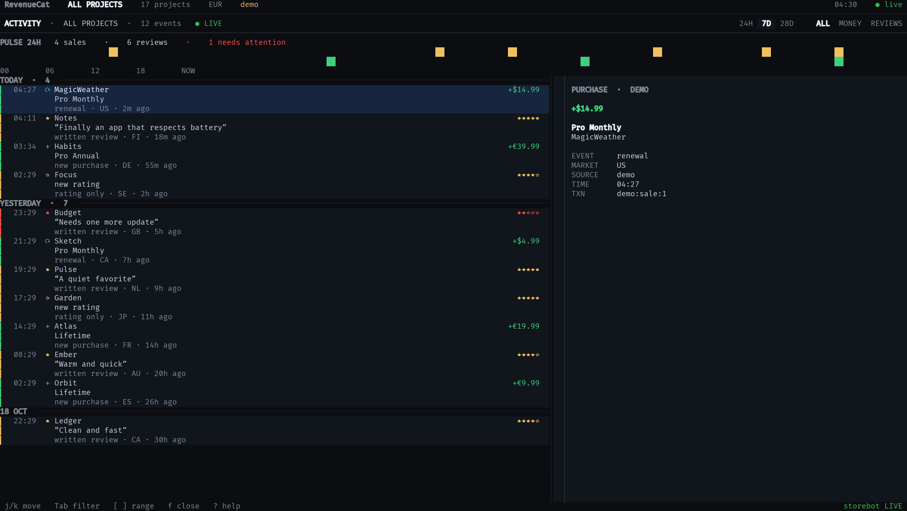
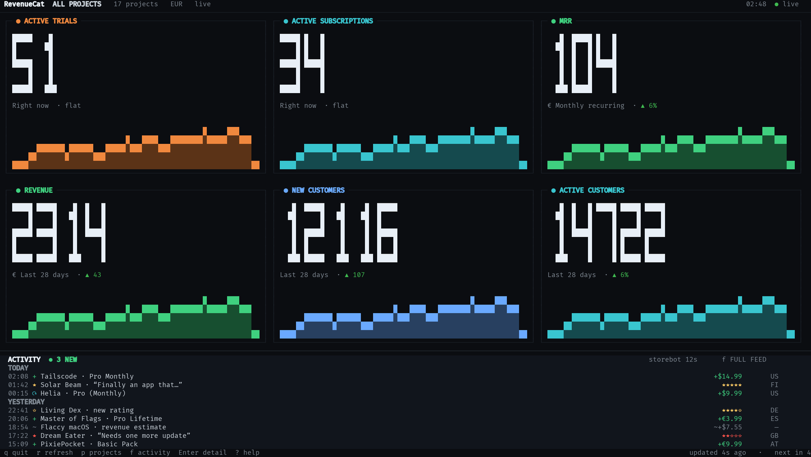

# Activity Feed — design and implementation spec

Status: **implemented**
Scope: the main rc-tui dashboard plus a read-only activity producer in storebot.



Layout exploration: [`activity-feed-iterations.md`](activity-feed-iterations.md).

## 1. Vision

The dashboard answers **“how is the business doing?”** The activity feed answers
**“what just happened?”** These are different questions, so they get different
visual weight.

Activity is a **market tape**, not a notification drawer and not a log viewer.
It should feel like part of the dashboard: quiet until something arrives,
specific when it does, and never allowed to shrink the metric cards into
illegibility.

Every event is a small card with a full app title, product or review title,
amount, territory and age. Titles wrap instead of truncating. A full view adds
the review text, event source, transaction identity and a quiet moment of
celebration for the events that deserve it.

### Design principles

1. **Protect the hero.** The six metric cards remain the first thing the eye
   lands on. Activity lives beside or below them, never on top and never at the
   cost of a card's numbers.
2. **Calm by default.** No blinking, no permanent animation, no badge noise.
   Motion exists only to acknowledge an arrival.
3. **One event, one identity.** A sale or review is shown exactly once. The UI
   and the Telegram bot share the same deduplicated event identity.
4. **Progressive disclosure.** The rail or shelf gives time, kind, app, product
   and amount. The full view gives the review body, source and metadata.
5. **Local and private.** rc-tui reads a local, mode-600 feed written by
   storebot. No Telegram token, no additional App Store or RevenueCat calls.
6. **Legible in a terminal.** No emoji in event rows. Country codes, stars and
   glyphs are measured and aligned for monospace cells. Control characters in
   review text are stripped before rendering.
7. **Failure is visible, not fatal.** A missing or stale feed never breaks the
   dashboard; it gets a precise, quiet health state.
8. **Celebrate the exception.** A first-ever sale, the first sale today, a big
   sale, a five-star review or a review that needs attention lights the whole
   activity section; in the full view it lights the whole screen. Ordinary
   events still get a small acknowledgement.

## 2. Architecture

```text
RevenueCat webhooks ──┐
Apple ASN ────────────┼──> storebot-hook (Cloudflare KV queue)
RevenueCat metrics ───┤                 │
ASC reviews ──────────┤                 v
iTunes rating counts ─┘          storebot (single instance)
                                         │
                       ┌─────────────────┴─────────────────┐
                       v                                   v
              ~/.local/state/storebot/feed.json       Telegram
                       │                            (at-most-once)
                       v
                    rc-tui
              (read-only, local poll)
```

- **storebot is the only writer.** It owns ingestion, normalization, dedupe,
  retention and the feed file.
- **Telegram is a delivery channel, not the source of truth.** The feed records
  an accepted event even when Telegram delivery is muted or fails.
- **rc-tui never calls App Store Connect, iTunes or Telegram for activity.**
  This avoids duplicate API load and keeps the feed consistent with what the
  bot already reported.
- The local file is v1. A future `GET /feed` on the relay can expose the same
  contract remotely without changing rc-tui's model.

## 3. Feed contract

### 3.1 Location and durability

```
${XDG_STATE_HOME:-~/.local/state}/storebot/feed.json
```

- Mode `0600`.
- Sidecar: `feed.alive` in the same directory, one Unix-millisecond line.
- Atomic writes: write `feed.json.tmp`, `fsync`, then `os.replace`.
- Storebot writes after each accepted event batch and refreshes the tiny
  `feed.alive` heartbeat at least every 60 seconds.
- Reader treats an unreadable or partial file as “no new data”; it keeps the
  last good in-memory snapshot and shows `feed unavailable` rather than
  crashing.
- rc-tui accepts an optional `feed_path` in `config.toml` for testing or for a
  non-default state directory.

### 3.2 Envelope

```json
{
  "version": 1,
  "written_at": 1760900004120,
  "entries": []
}
```

- `version` is the schema version. rc-tui supports `1`; higher versions show
  “feed requires a newer rc-tui” and do not parse entries.
- `written_at` is when this snapshot was written.
- `feed.alive` is the 60-second health heartbeat; it contains a single Unix
  millisecond value.
- `entries` is newest-first by `at` (then `received_at`, then `id`).

### 3.3 Entry shape

All entries share the same top-level keys. Type-specific fields live under
`purchase`, `review` or `rating`.

```json
{
  "id": "sale:txn:2000000123456789",
  "kind": "purchase",
  "at": 1760899680000,
  "received_at": 1760899684120,
  "app": "Tailscode: Coding Agent Remote",
  "project": "Tailscode",
  "project_id": "proj1a2b3c4d",
  "app_id": "",
  "country": "US",
  "source": "revenuecat",
  "text": "🆕 🌅 1st today 🇺🇸 Tailscode · Pro: +$14.99",
  "backfilled": false,
  "purchase": {
    "amount": 14.99,
    "currency": "USD",
    "product": "Pro",
    "product_id": "tailscode.pro.monthly",
    "event": "new",
    "environment": "production",
    "first_ever": false,
    "first_today": true,
    "estimated": false,
    "transaction_id": "2000000123456789"
  }
}
```

Review:

```json
{
  "id": "review:00000194-90ef-3f03-60ed-11c100000000",
  "kind": "review",
  "at": 1760897100000,
  "received_at": 1760899800000,
  "app": "Solar Beam",
  "project": "Solar Beam",
  "project_id": "proj...",
  "app_id": "1484270248",
  "country": "FI",
  "source": "asc_reviews",
  "text": "⭐⭐⭐⭐⭐ Solar Beam — “Finally an app that…” — nick 🇫🇮",
  "backfilled": false,
  "review": {
    "stars": 5,
    "title": "Finally an app that respects battery",
    "body": "The best solar app I have used. ...",
    "author": "nick"
  }
}
```

Rating-only:

```json
{
  "id": "rating:1484270248:de:84",
  "kind": "rating",
  "at": 1760896800000,
  "received_at": 1760900400000,
  "app": "Solar Beam",
  "project": "Solar Beam",
  "project_id": "proj...",
  "app_id": "1484270248",
  "country": "DE",
  "source": "itunes",
  "text": "Solar Beam — new rating, avg 4.8 🇩🇪",
  "backfilled": false,
  "rating": {
    "stars": 4,
    "count": 1,
    "average": 4.8
  }
}
```

### 3.4 Fields

| Field | Type | Notes |
|---|---|---|
| `id` | string | Stable dedupe identity. Never reused. |
| `kind` | `purchase` \| `review` \| `rating` | Unknown kinds are ignored by rc-tui. |
| `at` | int ms | Event time, not write time. |
| `received_at` | int ms | When storebot accepted it. |
| `app` | string | Display name shown first. |
| `project` | string | RevenueCat project or App Store app family. |
| `project_id` | string | RevenueCat project ID when known; empty otherwise. |
| `app_id` | string | App Store `trackId` when known; empty for RC-only. |
| `country` | string | ISO 3166-1 alpha-2, uppercase; empty when unknown. |
| `source` | string | `revenuecat`, `app_store`, `app_store_sales`, `revenuecat_fallback`, `storebot_log`, `asc_reviews`, `itunes`, `itunes_history`. |
| `text` | string | The exact Telegram line, sanitized for single-line display. |
| `backfilled` | bool | Seeded history; never sent to Telegram. |
| `purchase` | object | Present for purchases only. |
| `review` | object | Present for written reviews only. |
| `rating` | object | Present for stars-only ratings and all-time rating summaries. |

Purchase-specific:

| Field | Type | Notes |
|---|---|---|
| `amount` | number | Positive proceeds in the purchase currency. |
| `currency` | string | ISO currency code. |
| `product` | string | Display product name, may be empty. |
| `product_id` | string | Store product ID. |
| `event` | `new` \| `renewal` \| `trial_conversion` \| `purchase` \| `revenue` | `revenue` means an app-level fallback estimate. |
| `environment` | string | `production` only. Sandbox is excluded. |
| `first_ever` | bool | Project's first recorded sale. |
| `first_today` | bool | First sale for this project today (UTC). |
| `estimated` | bool | True only for the app-level revenue fallback. |
| `transaction_id` | string | Store transaction identity used for dedupe. |

Review-specific:

| Field | Type | Notes |
|---|---|---|
| `stars` | int 1–5 | |
| `title` | string | May be empty. |
| `body` | string | Sanitized, max 2,000 characters. |
| `author` | string | Public reviewer nickname. |

Rating-specific:

| Field | Type | Notes |
|---|---|---|
| `stars` | int 1–5 \| null | Inferred only when exactly one rating can be solved. |
| `count` | int | New ratings, or all-time ratings for a summary. |
| `average` | number | Storefront average at observation. |
| `summary` | bool | True for one all-time total per app; omitted by live rating entries. |

### 3.5 Identity and dedupe

| Event | Feed ID | Claim key |
|---|---|---|
| RevenueCat sale | `sale:txn:<transaction_id>` | `txn:<transaction_id>` |
| Apple ASN sale | `sale:txn:<transaction_id>` | `txn:<transaction_id>` |
| Sale without a transaction ID | `sale:event:<event_id>` | `event:<event_id>` |
| App Store daily row | `sale:appstore:<date>:<row_hash>` | `appstore:<date>:<row_hash>` |
| Revenue fallback | `sale:fallback:<project>:<day>:<value>` | same |
| Written review | `review:<review_id>` | same |
| Stars-only rating | `rating:<app_id>:<country>:<count>` | same |
| All-time rating total | `rating-history:<app_id>` | same |

- The sale key is the same one storebot uses to dedupe Telegram. There is one
  identity across RC, Apple and the feed.
- The relay forwards `transaction_id` and `original_transaction_id` from RC and
  Apple. The first source to claim a transaction wins; the second is
  acknowledged silently.
- `feed_seen` retains 5,000 IDs / 90 days. `sales_seen` uses the same limits.
- A feed entry is written **before** Telegram delivery. A failed send is still
  visible in rc-tui.

### 3.6 Time and retention

- `at` is the real event time. For a held stars-only rating, use the time the
  count increase was observed, not the release time. All-time rating totals are
  written when the history is seeded and carry `summary: true`.
- Feed retention: 500 entries and 90 days, whichever is smaller.
- rc-tui's full view offers 24h, 7d, 28d and **all** ranges; **all** is the
  default in the full view because the feed is the permanent business log.
- First install seeds **all available written reviews, one all-time rating
  total per app, and 14 days of paid App Store sales rows** with
  `backfilled: true`. RevenueCat live purchases and ratings continue from the
  install point; no fake history. App Store report rows are aggregate
  product/country/day rows, not individual transactions.

### 3.7 Producer normalization and first-run seed

- Country codes are normalized to ISO alpha-2 uppercase for the feed, even
  though Telegram lines keep their flag.
- `text` and all review fields are stripped of terminal control characters
  before they enter the feed. Newlines survive in `review.body`; `text` is
  single-line.
- Review bodies are capped at 2,000 characters.
- On first feed creation, storebot seeds every written review returned by the
  ASC customerReviews endpoint, plus one all-time rating total per app from the
  storefront counts. It also seeds 14 days of paid App Store sales rows and
  bootstraps purchases from today's and yesterday's storebot hook log. Seeded
  entries have `backfilled: true` and are never sent to Telegram. They are not
  counted as unread by rc-tui.
- Apple does not expose individual stars-only ratings through any public API.
  The per-app all-time total is the honest representation; rc-tui must not
  invent one event per star. Written reviews remain individual cards.
- RevenueCat live purchases continue from the install point; App Store report
  rows, review history and the hook-log bootstrap fill the history before it.
- App Store daily sales become `purchase` entries with
  `source = "app_store_sales"`, `event = "purchase"`, and a stable row hash
  built from the report date, SKU/parent, title, country, quantity, proceeds and
  currency (or the report's order number when present). The feed ID is
  `sale:appstore:<date>:<row_hash>`.
- Revenue fallback entries use `event = "revenue"` and `estimated = true`;
  their amount is the app-level delta.
- Milestones, coverage alerts and command replies are not activity events and
  never enter the feed.

### 3.8 Warmth and health

| Condition | Header state | Meaning |
|---|---|---|
| `feed.alive` ≤ 180s ago | `● LIVE` | storebot is writing. |
| 180s–10min | `● STALE 4m` | process may be busy or wedged. |
| > 10min or missing `feed.alive` | `● OFFLINE` | feed is not being updated. |
| Parse/version error | `FEED ERROR` | last good entries remain visible. |

A feed can be offline while metrics are live. Show both truths; do not fake a
live dot.

## 4. Main dashboard layout

The layout was iterated three times. The full exploration and critique is in
[`activity-feed-iterations.md`](activity-feed-iterations.md); this section
specifies the chosen third pass.

### 4.1 Adaptive layout

```text
┌ header ───────────────────────────────────────────────────────────────────────┐
├ rule ─────────────────────────────────────────────────────────────────────────┤
│                                                                               │
│  six metric cards (3 x 2)                            │  ACTIVITY  ● 3 NEW  f  │
│                                                       │  PULSE 24H   24 events │
│                                                       │  ▂▃▅▂▇▃▁▂▄▆...        │
│                                                       │  ATTENTION · 1         │
│                                                       │  ★★☆☆☆ Dream Eater      │
│                                                       │  “Needs one more…”     │
│                                                       │  GB · written · 2h     │
│                                                       │  LIVE 3 NEW            │
│                                                       │  02:08 + Tailscode     │
│                                                       │  01:42 ★ Solar Beam    │
│                                                       │  “Finally an app…”     │
│                                                       │  ...                   │
├ footer ────────────────────────────────────────────────────────────────────────┤
└───────────────────────────────────────────────────────────────────────────────┘
```

| Condition | Layout |
|---|---|
| `width >= 172 && body_h >= 43` | **Pulse rail** on the right, cards left |
| `width >= 96 && body_h >= 40` | Full-width **shelf** of event cards below the cards |
| `width >= 96 && body_h 30–39` | Compact shelf of event cards, 8 rows |
| `width >= 96 && body_h >= 18` | Two-line ticker above the footer |
| `width < 96 || body_h < 18` | One-line ticker above the footer |
| `wall` mode | Hidden |
| detail view | Hidden |

The rail is chosen only where it genuinely improves the screen:

- `rail_w = clamp(round(width * 0.285), 48, 64)`.
- One-cell gutter, then cards use the remaining width.
- If `left_w / 3 >= 44`, use **3×2** cards; otherwise use **2×3**.
- At 200×54: rail 57, cards 45×24. The charts gain height while every
  five-digit metric stays legible.
- At 172×46 (body 43): rail 49, cards 60×14 in 2×3. The rail earns its width;
  the cards keep readable numbers.
- At 140×44: shelf 9 rows of cards; the metric grid keeps its current space.
- At 120×36: compact shelf, 8 rows; each event card gets full title wrapping.
- At 100×28: two-line ticker; the metric grid keeps its current space.
- Page/scale behavior is unchanged. Fewer cards per page give each card more
  cells; the rail width does not change.

### 4.2 Pulse rail (wide layout)

The rail is a **live instrument**, not a log drawer. It occupies the vertical
space beside the cards that the shelf design left unused, and it uses its 57
columns for context rather than empty gutter.

```text
 ACTIVITY                         ● 3 NEW              f
 PULSE 24H                                     24 EVENTS
 ▂▃▅▂▇▃▁▂▄▆▃▂▁▃▅▇▅▂▁▂▃▅▆▄▂
 ─────────────────────────────────────────────────────
 ATTENTION · 1
 ★★☆☆☆  Dream Eater
 “Needs one more update”
 GB · written review · 2h
 ─────────────────────────────────────────────────────
 LIVE  3 NEW
 02:08  +  Tailscode · Pro Monthly              +$14.99  US
 01:42  ★  Solar Beam                          ★★★★★  FI
          “Finally an app that respects…”
 00:15  ⟳  Helia · Pro (Monthly)                +$9.99  US
 22:41  ☆  Living Dex · new rating             ★★★★☆  DE
 20:06  +  Master of Flags · Pro Lifetime       +€3.99  ES
 ...
────────────────────────────────────────────────────────
 storebot 12s                                  f FULL FEED
```

- **Pulse strip.** 24 hourly bins for the last 24 hours. Each bin stacks
  purchases (green) below reviews (gold); height is normalized within the rail.
  A quiet hour is a one-cell baseline, not a blank. The total is shown at the
  right. This is the “horizontal space” payoff: a temporal shape that a
  one-line feed could not show.
- **Attention.** If there is an unseen 1–2★ written review in the last 7 days, pin
  the newest one here with stars, app, quote and territory. If none, omit the
  block entirely; the stream moves up. Never rotate or auto-dismiss it. The
  pinned review is omitted from the stream below so it appears exactly once;
  it also clears as soon as the full activity view has marked it read.
- **Live stream.** Newest first, last **7 days**, with date separators. The
  pulse is deliberately the only 24-hour surface; the stream stays useful for
  low-volume apps whose last review was days ago. Every event is a compact card:
  - first line: time, glyph, full app title, right-aligned amount or stars;
  - second line: full product name, or the full written-review title in quotes;
  - third line: event type, territory and age.
  Titles wrap to as many lines as they need; they are never shortened with an
  ellipsis. The rail needs 48–64 columns because a title may wrap there.
- The rail is not focusable. `f` opens the full activity view; the rail itself
  is a glance.
- If the rail overflows, its header shows `+N`; the stream is not scrollable.
- At 172 columns, the rail still shows the pulse, attention and at least six
  events; cards switch to 2×3 rather than becoming unreadable.

### 4.3 Shelf fallback (standard layout)

Below the rail breakpoint, the full-width shelf becomes a horizontal strip of
event cards. It uses the width for parallel stories instead of one thin line.

```text
 ACTIVITY  ● 3 NEW   LIVE                              f FULL FEED
 ▎ 02:08  +  Tailscode: Coding Agent Remote       +$14.99
 ▎          Tailscode Pro
 ▎          new purchase · US · 2h ago
 ─────────────────────────────────────────────────────────────
 ▎ 01:42  ★  Solar Beam                           ★★★★★
 ▎          “Finally an app that respects battery”
 ▎          written review · FI · 18m ago
```

- Two to four cards share the shelf, each with a colored left spine, full title,
  full product/review title and metadata.
- Titles wrap; they never use an ellipsis. Values stay right-aligned.
- A card can be 4–6 rows tall. The shelf height is `7` at `body_h >= 30`, and
  `clamp(round(body_h * 0.22), 7, 10)` at `body_h >= 40`.
- If more events exist than shown, the header reports `+N MORE`; `f` opens the
  full feed.

### 4.4 Ticker

When neither the rail nor shelf fits:

```text
● 02:08  +  Tailscode: Coding Agent Remote              +$14.99
    Pro Monthly · US                         LIVE   f ACTIVITY
```

- Two rows when the terminal can spare them, one otherwise.
- The app title is never abbreviated. It may wrap to the second row; metadata
  follows on the same row when it fits.
- `f` opens the full feed; `N NEW` replaces the leading dot when unread.

### 4.5 Celebration

A new event that crosses the significance line takes over the activity surface
for 2.6 seconds.

| Event | Banner | Surface |
|---|---|---|
| First-ever sale | `FIRST EVER SALE` | money accent |
| First sale today | `FIRST SALE TODAY` | money accent |
| Sale ≥ 25 | `BIG SALE` | money accent |
| Five-star review | `FIVE STARS` | star accent |
| Written review ≤ 2★ | `NEEDS ATTENTION` | alert accent |
| Any other new event | `NEW SALE` / `NEW REVIEW` / `NEW RATING` | compact banner only |

- **Rail and shelf:** the whole activity section — header, pulse, cards and
  metadata — is washed with a low-alpha accent, a light sweep crosses it, and
  the banner names the event. Ordinary events get only the compact banner.
- **Full activity view:** the whole screen is washed and swept. The selected
  event jumps to the new item so the detail panel agrees with the celebration.
- **Motion:** `minimal` keeps the banner and wash without the sweep; `off` keeps
  only the banner. No permanent animation, no blinking.
- **No title truncation anywhere in the celebration.** The banner may wrap; it
  never replaces the full title in the card or detail panel.

### 4.6 Empty, stale and disconnected states

| State | Rail / shelf body |
|---|---|
| No file yet | `Activity feed not connected · run storebot to start` |
| Empty, live | `Listening for the next sale or review · started 2m ago` |
| Storebot offline | Last events remain; header `OFFLINE`; first line `No feed updates for 14m` |
| Filtered empty in full view | Centered: `No purchases in the last 24h` |
| Demo | Deterministic fixture; header says `demo feed`; no writes |

## 5. Full activity view

`f` opens it. The global header and footer remain; the body becomes the
activity workspace.

### 5.1 Wide layout (≥150 columns)



```text
 ACTIVITY · ALL PROJECTS                            24H   7D   28D      ALL  MONEY  REVIEWS
 ───────────────────────────────────────────────────────────────────────────────────────
 TODAY
 02:08  +  Tailscode · Pro Monthly                          +$14.99  US
 01:42  ★  Solar Beam — “Finally an app that respects…”      ★★★★★  FI
 00:15  ⟳  Helia · Pro (Monthly)                             +$9.99  US
 ...
 ───────────────────────────────────────────────────────────────────────────────────────
 ★★★★★  Solar Beam                                         Finland · 2h ago
 “Finally an app that respects battery”
 The best solar app I have used. It shows the forecast clearly, ...
 — nick · written review · App Store
```

- List pane 62%, detail pane 38%, separated by a 2-cell gutter and a vertical
  `BORDER` rule.
- List header includes scope, range and filter. Active chips use `BRIGHT` with
  a `SURFACE` background; inactive chips use `DIM`.
- Selected row uses `SELECTION` background and a 1-cell category accent bar.
- A 1-cell scrollbar sits on the right edge of the list; thumb `DIM`, track
  `BORDER`.
- The detail pane is a calm, text-first inspector. A left `BORDER_STRONG`
  spine and a label (`PURCHASE`, `WRITTEN REVIEW`, `RATING`) establish
  hierarchy.

### 5.2 Narrow layout (<150 columns)

- Stack list above detail.
- List gets 60% of the body, detail 40%.
- At <30 body rows, show only the list; `Enter` opens a centered detail modal
  over it.
- The selected row remains visible while the detail scrolls.

### 5.3 Detail content

Purchase:

```text
 PURCHASE · REVENUECAT
 +$14.99
 Pro Monthly
 Tailscode: Coding Agent Remote
 Renewal · United States · 02:08
 transaction 2000000123456789
```

- For an estimated revenue fallback: label `REVENUE ESTIMATE`, amount prefixed
  `~+`, and a line `App-level delta; no per-sale detail`.
- First-ever/first-today tags appear as small uppercase labels under the
  amount, not as emoji.

Review:

```text
 WRITTEN REVIEW · APP STORE
 ★★★★★
 “Finally an app that respects battery”
 Solar Beam · Finland · 2h ago
 — nick

 The best solar app I have used. It shows the forecast clearly, ...
```

- Title in `BRIGHT`; body in `TEXT`; author and metadata in `DIM`.
- Body wraps to the detail width; `j/k` scrolls if it exceeds the pane.
- Control characters are stripped; newlines are preserved in the detail and
  collapsed to spaces in the list.

Rating:

```text
 RATING HISTORY · ITUNES_HISTORY
 avg 4.7
 Master of Flags: World Quiz
 RATINGS   24
 AVERAGE   4.7
 SOURCE    itunes_history
```

- Live stars-only ratings keep the `RATING ONLY` shape. The one-time all-time
  total uses `RATING HISTORY` and is shown only in the **all** range.
- If the star value could not be solved: no star row; show `New rating · avg
  4.8` instead.

### 5.4 Filtering and ranges

| Key | Action |
|---|---|
| `Tab` | All → Purchases → Reviews (written + ratings) |
| `[` / `]` | 24h → 7d → 28d → all (default **all**) |
| `j` / `k` | Move selection |
| `g` / `G` | First / last |
| `PgUp` / `PgDn` | Page |
| `Enter` | Open detail on narrow layouts |
| `Esc` / `f` / `q` | Close activity |
| `?` | Help |

- Scope follows the dashboard: `All projects`, or the selected project.
- Scope matching: exact `project_id` first, then case/punctuation-insensitive
  `project`/`app` name, then All-only. Unmatched events are never hidden from
  All.
- The active filter/range is shown in the header; counts update live.
- New events while the list is scrolled do not move the viewport. A small
  `3 NEW ABOVE` indicator appears at the top; `g` jumps to them. At the top,
  new rows appear immediately with the arrival animation.

### 5.5 Unread model

- `feed_seen_at` is the newest **`received_at`** the user has seen in the full
  view; persisted in `config.toml` as Unix milliseconds. Use `received_at`,
  not the event's `at`, so a delayed held rating still counts as unread until
  it has actually been shown.
- Opening the full view marks everything through the current newest entry as
  read. Closing it does not mark later arrivals.
- The rail or shelf shows `N NEW`; the full view header shows `N NEW` only while
  scrolled away from the top.
- Demo mode never writes `feed_seen_at`.

## 6. Visual language

### 6.1 Tokens

Reuse the existing theme:

| Token | Use |
|---|---|
| `BG` | Canvas and card interior |
| `SURFACE` | Activity rail, shelf and full-view list background |
| `BORDER` / `BORDER_STRONG` | Rules, scrollbar, separators |
| `TEXT` | App names, review titles |
| `BRIGHT` | Active labels, selected review title |
| `DIM` | Time, metadata, product, empty states |
| `MONEY` | Purchases and unread count |
| `RETENTION` | Renewals |
| `TRIAL` | Trial conversions |
| `GOOD` / `WARN` / `BAD` | Positive, stale/ambiguous, low-star/error |
| `SELECTION` | Selected activity row |

Add two semantic aliases in code, not new hues:

- `ACTIVITY_REVIEW = WARN` (gold stars)
- `ACTIVITY_MONEY = MONEY`

Low-star reviews (1–2) color the filled stars `BAD` and add a 1-cell `BAD` left
edge. The rest of the row remains neutral; do not paint the whole row red.

### 6.2 Glyphs

| Glyph | Meaning | Color |
|---|---|---|
| `+` | New purchase or paid download | `MONEY` |
| `⟳` | Renewal | `RETENTION` |
| `◐` | Trial conversion | `TRIAL` |
| `★` | Written review | `WARN` (or `BAD` for 1–2) |
| `☆` | Rating-only | `WARN` |
| `~` | App-level estimate | `DIM` |

No emoji in rows. The exact Telegram text remains available in `text` and in
the detail view if the user wants parity; the dashboard speaks terminal.

`★`/`☆` are U+2605/U+2606 and are single-cell. The live app relies on the
terminal's symbol fallback because FiraCode does not contain them; the README
capture renderer must draw them with a symbol-capable fallback (the design
mockups use vector stars for this reason). `⟳` is supported by FiraCode and is
preferred over `↻`, which is not. Never use Nerd Font private-use stars for a
public screenshot.

### 6.3 Type and spacing

- Section labels (`ACTIVITY`, `TODAY`, `PURCHASE`) are uppercase, `BOLD`,
  `DIM`/`BRIGHT`.
- App names are sentence case, never uppercased; the card titles already carry
  the uppercase voice.
- Review quotes use the title if present, otherwise a sanitized body excerpt.
- One space after a full stop in prose; no letter-spacing hacks.
- **Rule of three:** at most three text tones per row: primary (app), secondary
  (product/quote), tertiary (time/country).
- Padding: 2 cells left/right in the shelf or rail; 2 cells in the full view.
- Date headers replace a blank row; do not use extra vertical padding between
  every event.

### 6.4 Amounts

- Preserve the sale currency; do not normalize to EUR in the feed row.
- `+€14.99`, `+$9.99`, `+kr199.00`; JPY/KRW omit decimals if the existing
  formatter does.
- Right-align in a 10-cell column; if the value is longer, widen to 12 at the
  expense of the body column.
- Estimated values use `~+$7.55` and are never confused with a transaction.

### 6.5 Stars

- Five glyphs: filled `★`, empty `☆`.
- Integer review ratings straightforward.
- Rating-only with a solved star value shows filled stars.
- Rating-only without a solved value shows `avg 4.8` in the value column and no
  star row in the detail.
- Multi-rating aggregate shows `3 ratings · avg 4.8→4.9`, not five stars.

## 7. Motion

Motion is acknowledgement, not decoration. Respect the existing
`motion = full | minimal | off`.

| Moment | Full | Minimal | Off |
|---|---|---|---|---|
| New event arrives in rail/shelf | 450ms accent wash + 1-cell slide-in | 180ms fade | instant |
| New event count increments | one 300ms brightness pulse | none | none |
| Full view opens | 160ms fade/1-cell rise | 120ms fade | instant |
| Selection moves | none (instant background) | none | none |
| Feed goes stale/offline | no animation; color/status change | same | same |

- Never animate the rail width or shelf height; new rows push older ones
  within a fixed band.
- If a new event arrives while the user is reading a review in the full view,
  do not steal selection or scroll. Show the `N NEW ABOVE` marker.
- `tachyonfx` areas must be clipped to the rail/shelf/list rect; no full-screen
  effects for feed arrivals.

## 8. Implementation in rc-tui

### 8.1 Modules and types

```
src/activity.rs      feed schema, parser, sanitizer, scope matching, unread
src/app.rs           ActivityState, timer, config integration, keys
src/ui.rs            pulse rail, shelf, ticker, full view, rows, detail
src/config.rs        feed_seen_at, optional feed_path
```

Proposed model:

```rust
struct ActivityFeed {
    version: u32,
    written_at: i64,
    entries: Vec<ActivityEntry>,
}

struct ActivityEntry {
    id: String,
    kind: ActivityKind,
    at: i64,
    received_at: i64,
    app: String,
    project: String,
    project_id: String,
    app_id: String,
    country: String,
    source: ActivitySource,
    text: String,
    backfilled: bool,
    purchase: Option<Purchase>,
    review: Option<Review>,
    rating: Option<Rating>,
}
```

- Use `serde` with `#[serde(default)]` for optional fields and unknown kinds.
- Timestamps are Unix milliseconds; convert to `DateTime<Local>` for display.
- `ActivityState` in `App` holds entries newest-first, a dedupe `HashSet`, the
  last mtime/len, health, seen timestamp, full-view filter/range/selection and
  scroll offset.
- `demo` uses a deterministic embedded fixture, not the live feed file.

### 8.2 Polling

- Poll every **2 seconds** from `App::tick`, regardless of the 5-minute metric
  cadence.
- `std::fs::metadata(path)` first; read only when `mtime` or `len` changes.
- Parse off the draw path; a 500-entry file is small. If parsing ever becomes
  measurable, move it to the worker thread; v1 keeps it on the UI thread with a
  <2ms budget.
- A malformed file replaces nothing: keep the last good snapshot and set
  `FeedHealth::Error`.
- Feed changes set `animating_until = now + 1s` so the next frame can show the
  arrival, but do not trigger a metrics refresh.

### 8.3 Config

```toml
feed_seen_at = 1760900000000   # optional; newest activity viewed
feed_path = "/custom/feed.json" # optional; default XDG state path
```

- `feed_seen_at` saves when the full view opens, using the newest
  `received_at`.
- `feed_path` is read-only; rc-tui never creates or writes the feed.
- Demo and wall modes never write UI preferences.

### 8.4 Rendering

- `draw_dashboard` chooses rail, shelf or ticker from the responsive rules.
  The rail split is horizontal (`[cards, rail]`); the shelf split is vertical
  (`[cards, shelf]`).
- `draw_activity_rail` draws the pulse strip, attention pin, header, date
  separators and event cards.
- `draw_activity_shelf` draws the top rule, header and a horizontal row of
  event cards.
- `draw_activity_ticker` draws the compact one/two-line variant.
- `draw_activity` replaces `draw_body` when the full view is open;
  `draw_activity_list` and `draw_activity_detail` render the panes.
- `make_feed_card` wraps full app titles, product names and written-review
  titles with a display-width-aware helper. It never inserts an ellipsis in a
  title.
- `draw_celebration` paints the section or full screen for significant events.
- Keep card and selection calculations pure and unit-testable.

### 8.5 Keys

Add to dashboard:

| Key | Action |
|---|---|
| `f` | Open full activity |
| `?` | Existing help, extended with activity keys |

Full view:

| Key | Action |
|---|---|
| `f`, `Esc`, `q` | Close activity |
| `j`/`k`, `↓`/`↑` | Move selection |
| `g`/`G` | First/last |
| `PgUp`/`PgDn` | Page |
| `Tab` | Cycle All/Purchases/Reviews |
| `[`/`]` | Cycle 24h/7d/28d/all |
| `Enter` | Open detail modal on narrow layouts |
| `?` | Help |

`Ctrl+C` always quits. `q` inside the full view closes the view, not the app;
`Esc` does the same. `f` is unused today and does not conflict with the picker,
detail, health or help modes.

### 8.6 Scope, unread and persistence

- `scope` follows the dashboard; the feed header prints the scope label.
- The feed filter never changes the metric scope.
- `feed_seen_at` is monotonic: never move backwards if the clock or feed is
  older. Compare it to `received_at`.
- On first run with a populated feed, unread is the number of entries with
  `received_at` newer than `feed_seen_at` within 7d; if the key is absent,
  treat the feed as read from its oldest entry (no giant badge on first
  launch).
- If an event's timestamp is more than 5 minutes in the future, clamp its
  display age to “now” but keep its sort key.

### 8.7 Performance budgets

| Budget | Target |
|---|---|
| Idle CPU added by feed | < 0.1% |
| Feed file read/parse (500 entries) | < 2ms on change only |
| Extra draw time for rail/shelf | < 0.5ms at 140×44, < 1ms for the 200×54 rail |
| Memory for 500 entries | < 2 MiB |
| Network calls added to rc-tui | 0 |
| Feed-to-screen latency | ≤ 2.5s after storebot write |

### 8.8 Failure behaviour

- Missing feed: empty state, metrics unaffected.
- Bad JSON: last good entries + `FEED ERROR`; log once per file version.
- Unknown source/kind: ignore the entry, keep the rest.
- Future schema: header message; do not parse.
- Huge review: sanitize and cap at 2,000 chars; detail scrolls.
- Terminal control bytes: strip before any row/detail rendering.
- Clock skew: clamp future ages; sort by `at` with stable tie-break on `id`.

## 9. Storebot producer and duplicate remaster

### 9.1 Why storebot owns it

Storebot already has the only complete picture of live events: RC webhook
detail, Apple ASN, review text, rating counts, the fallback revenue metric and
the app's Telegram identity. Duplicating that in rc-tui would mean a second set
of credentials, a second set of rate limits and a second dedupe policy.

### 9.2 One event, one claim

The canonical flow for every event:

1. Normalize to a stable identity.
2. Claim the identity in the persistent ledger.
3. Build the feed entry and the Telegram line from the same data.
4. Persist state and the feed atomically.
5. Deliver Telegram at most once.
6. Acknowledge the relay queue.

If step 5 fails, the feed still has the event and the log records the failure.
If step 4 fails, nothing is claimed, so the event can be retried.

### 9.3 Duplicate paths and policy

| Path | Identity | Policy |
|---|---|---|
| RevenueCat redelivery | RC `event_id` | `seen_events` skips. |
| RC webhook + Apple ASN for one sale | store `transaction_id` | One `sales_seen` claim; second is acknowledged silently. |
| Relay duplicate append | RC `event_id` | `/hook` queue now checks before append; `/asn` already did. |
| Revenue fallback before hook arrives | project + fallback timestamp | Fallback only for projects with no proven hook; after a fallback ping, hooks are suppressed for 30min. |
| Revenue fallback after hook | project `hook_seen` | No app-level delta ping once a project has ever delivered a hook. |
| iTunes count before written review | app + country + count | Stars-only pings are held two review cycles + 5min; a written review cancels one pending rating. |
| Rating count wobble | high-water count | Lower reads are absorbed; never re-ping. |
| Review poll replay | review ID | `reviews_seen` skips. |
| App Store daily + ASN | app live coverage | Daily IAP rows are suppressed when the app is live-covered. |
| Telegram timeout after accept | per chunk | At-most-once send; do not retry ambiguous failures. |
| Two bot processes | PID lock | Second process exits before polling. |

### 9.4 Storebot implementation points

- `storebot-hook` forwards `transaction_id`, `original_transaction_id` and
  purchase timestamp for both RC and Apple events. It dedupes the RC queue by
  `event_id` like the ASN queue.
- `sales_seen` is a 90-day / 5,000-entry transaction ledger.
- `fallback_sent` records the last fallback ping per project; `hook_seen`
  records a real webhook delivery.
- `rating_holds` is the pending stars-only ledger; `review_pending` keeps the
  written-review bank used to subtract from future counts.
- `feed.json` is written from the accepted event before Telegram delivery;
  `feed.alive` refreshes on the main loop without rewriting the full feed.
- On first creation, storebot backfills 14 days of paid App Store rows, every
  available written review, one all-time total per app, and the current two
  days of hook-log purchases. Existing feed signatures prevent a live sale from
  being repeated by the historical report.
- `/off` mutes Telegram only; ingestion, dedupe and the feed continue. (This is
  a deliberate change: the feed is the business log, not a notification log.)
- One `fcntl.flock` instance lock at startup.
- `sendMessage` uses at-most-once semantics: retry 429 only, retry `getUpdates`
  and other safe calls as before, never retry an ambiguous send timeout.

### 9.5 Known limits

- A fallback ping followed by a hook arriving after the 30-minute grace can
  still duplicate; the grace equals several hook ticks and covers normal relay
  delay. A longer outage should surface in coverage/health rather than send
  twice.
- A written review arriving more than one rating-hold window after the count
  can still duplicate; the hold is configurable through the review interval.
- Legacy queued events without a transaction ID cannot be cross-source
  deduped; the relay now forwards the field for all new events.
- The KV relay is last-writer-wins under concurrent posts; that can lose an
  event, not duplicate one. A Durable Object is the future fix if loss becomes
  a problem.
- At-most-once Telegram can lose a message on an ambiguous timeout; that is
  the explicit trade for “never duplicate”.

## 10. Mockups

### 10.1 200×54 pulse rail dashboard


The final wide layout: six 45×24 metric cards on the left, a 57-column pulse
rail on the right. The rail carries the 24-hour pulse, attention review and
two-line activity stream.

### 10.2 140×44 shelf dashboard



```text
RevenueCat  ALL PROJECTS  17 projects  EUR  live                         02:48  ● live

 ● ACTIVE TRIALS                    ● ACTIVE SUBSCRIPTIONS              ● MRR
   51                                 34                                 104
   Right now · flat                  Right now · flat                   €104 · ▲6% vs last week
   ▁▂▃▅▆▇█▇▆▅▄▃▂▁▂▃▄▅▆▇█             ▁▂▃▄▅▆▇█▇▆▅▄▃▂▁▂               ▁▂▃▄▅▆▇█▇▆▅▄▃

 ● REVENUE                          ● NEW CUSTOMERS                    ● ACTIVE CUSTOMERS
   2314                               12116                              14722
   € Last 28 days · ▲43               Last 28 days · ▲107               Last 28 days · ▲6%
   ▁▂▃▄▅▆▇█▇▆▅▄▃▂▁▂▃▄▅▆              ▁▂▃▄▅▆▇█▇▆▅▄▃▂▁▂▃              ▁▂▃▄▅▆▇█▇▆▅▄▃

──────────────────────────────────────────────────────────────────────────────
 ACTIVITY  ● 3 NEW                              storebot 12s   f FULL FEED
 TODAY
 02:08  +  Tailscode · Pro Monthly                         +$14.99  US
 01:42  ★  Solar Beam · “Finally an app that…”            ★★★★★  FI
 00:15  ⟳  Helia · Pro (Monthly)                            +$9.99  US
 YESTERDAY
 22:41  ☆  Living Dex · new rating                        ★★★★☆  DE
 20:06  +  Master of Flags · Pro Lifetime                 +€3.99  ES
 18:54  ~  Flaccy macOS · revenue estimate                  +$7.55  —
──────────────────────────────────────────────────────────────────────────────
 q quit  r refresh  p projects  f activity  Enter detail  ? help      updated 4s ago
```

### 10.3 100×30 dashboard

```text
RevenueCat  ALL PROJECTS  17 projects  EUR                      02:48  ● live

 ● ACTIVE TRIALS              ● ACTIVE SUBSCRIPTIONS              ● MRR
   51                           34                                 104
   Right now · flat             Right now · flat                   €104 · ▲6%

 ● REVENUE                    ● NEW CUSTOMERS                   ● ACTIVE CUSTOMERS
   2314                         12116                             14722
   Last 28 days · ▲43           Last 28 days · ▲107               ▲6%

──────────────────────────────────────────────────────────────────────────────
● 02:08  +  Tailscode · Pro Monthly  +$14.99  ·  01:42  ★  Solar Beam  ★★★★★   f
 q quit  r refresh  p projects  f activity  ? help                 updated 4s ago
```

### 10.4 200×54 full activity


The full view is a 24-hour pulse strip, a card list with full titles, and a
detail panel with the complete review text or transaction identity. Dates are
grouped; every card carries its own left spine and right-aligned value.
 ★★★★★  Solar Beam                                              Finland · 2h ago
 “Finally an app that respects battery”
 The best solar app I have used. It shows the forecast clearly, ...
 — nick · written review · App Store
```

## 11. Test plan and acceptance criteria

### 11.1 Data tests

- Parse a 500-entry feed under 2ms.
- Unknown kind/source is ignored without dropping valid entries.
- Duplicate IDs collapse; the newest `received_at` wins.
- Future schema shows a controlled error.
- Review control characters are stripped; newlines collapse in rows and
  survive in detail.
- Scope matching uses project ID first, then normalized names.
- Unread count handles absent/old/future `feed_seen_at`.

### 11.2 UI tests with `TestBackend`

- 200×54: pulse rail 57 columns; six 45×24 cards; pulse, attention and stream
  all render.
- 172×46: rail 49 columns; cards switch to 2×3 and remain readable.
- 140×44: shelf 9 rows; cards remain ≥14 inner rows.
- 100×30: ticker; cards keep their existing layout.
- Empty, live, stale, offline, parse-error and filtered-empty states.
- Full view at 200×54 (split) and 100×30 (stacked/modal).
- Long review body wraps and scrolls; no terminal escape leakage.
- New event while scrolled shows `N NEW ABOVE` and does not move selection.
- Demo feed is deterministic; no config write.

### 11.3 Storebot tests

- Two events with the same transaction ID but different event IDs produce one
  feed entry and one Telegram line.
- A hook event after a fallback ping is acknowledged and not sent.
- A written review cancels a pending stars-only hold.
- A rating count wobble does not re-ping.
- A second process exits on the lock.
- A simulated Telegram timeout sends once and logs the failure.
- `--selftest` passes; the service restart log is clean.

### 11.4 Acceptance

- The main view shows recent purchases and reviews without a keypress.
- A new sale appears in rc-tui within 2.5s of the storebot feed write.
- No duplicate Telegram ping or feed entry across RC, ASN, fallback, review
  and rating paths in the simulation suite.
- Idle CPU and RSS stay within the existing envelope.
- `cargo test`, clippy and the storebot selftest pass.
- README demo screenshot includes the pulse rail.

## 12. Rollout

1. **Storebot producer** (partly done): finish `feed.json`, heartbeat, feed
   entries for all money/review/rating paths, and the `/off` decoupling.
2. **rc-tui model + rail/shelf**: read-only feed, health, unread, scope
   matching, responsive rail/shelf/ticker, demo fixture.
3. **Full activity view**: list, detail, filters, ranges, motion.
4. **Polish**: screenshot, README, config docs, tests, install.
5. **Verify live**: one real sale and one review should appear once in both
   Telegram and rc-tui.

## 13. Decisions locked

- Activity uses a **pulse rail at wide widths**, a full-width shelf at standard
  widths, and a one-line ticker at narrow/short widths. The rail is the chosen
  third iteration; the shelf remains the fallback.
- **One-line ticker** at narrow/short terminals; `f` always opens the full
  view.
- **Local feed file** first; the relay HTTP endpoint can come later with the
  same schema.
- **No emoji in rows**; country codes and terminal glyphs. Telegram text is
  preserved in the detail.
- **Purchases before install** come from 14 days of App Store sales reports plus
  the current two days of hook-log purchases; RevenueCat live purchases start at
  install. Written reviews are seeded for 28 days.
- **Stars-only ratings are held** for two review cycles plus five minutes.
- **Wall mode hides activity**; detail and modal views hide it too.
- **`f` is the only new dashboard key**; full-view keys are modal.
